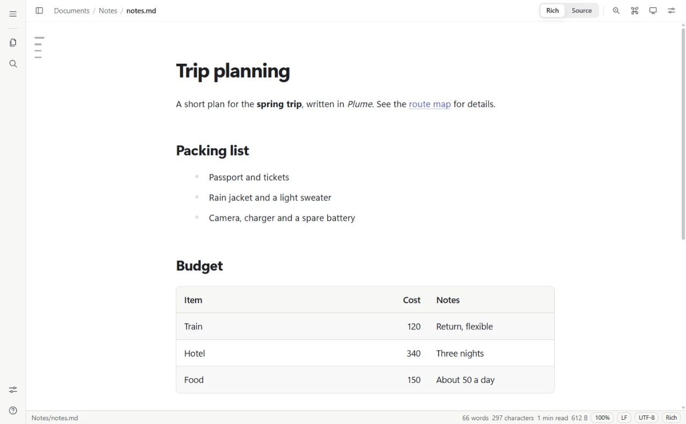
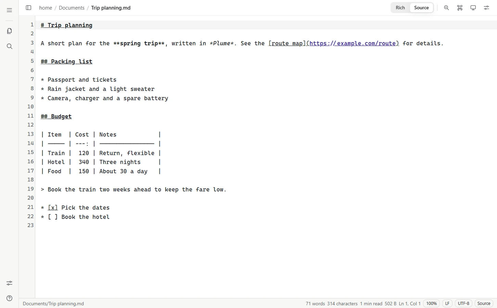
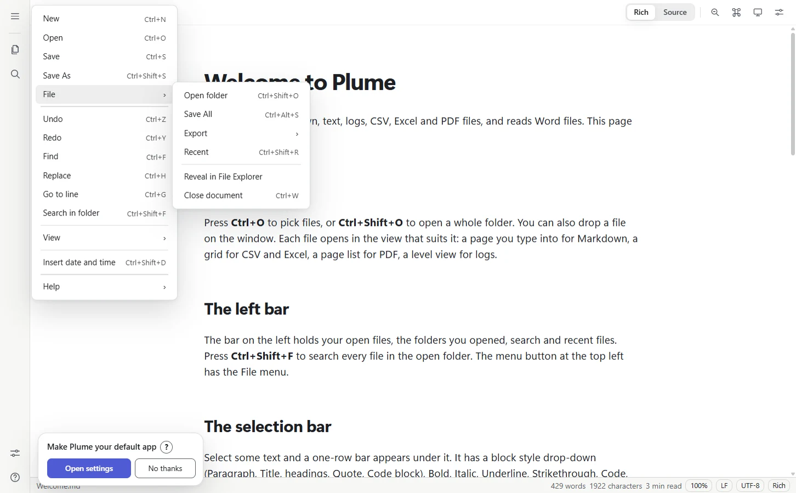
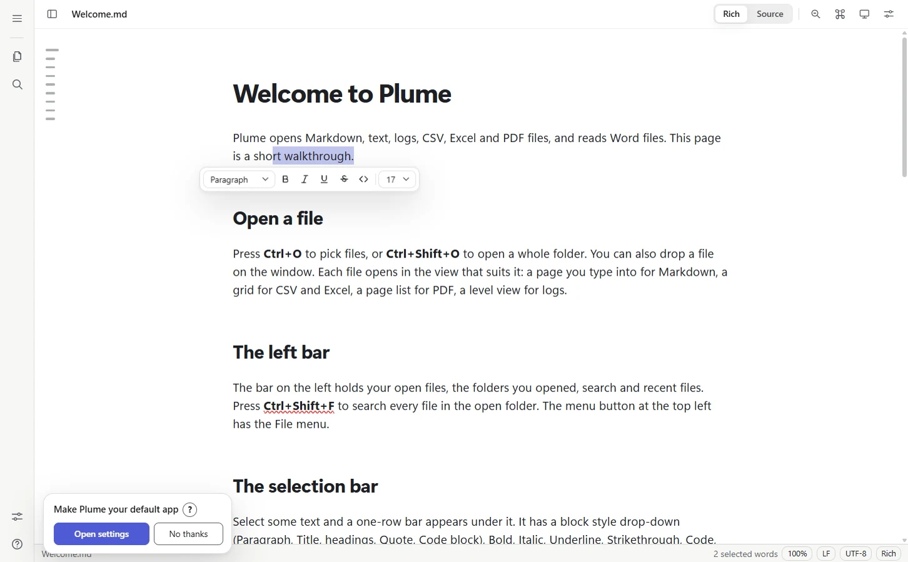
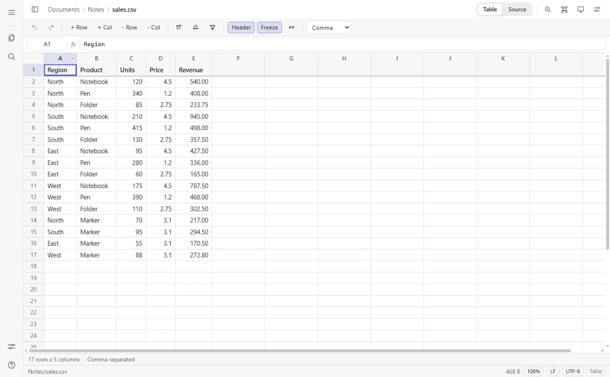
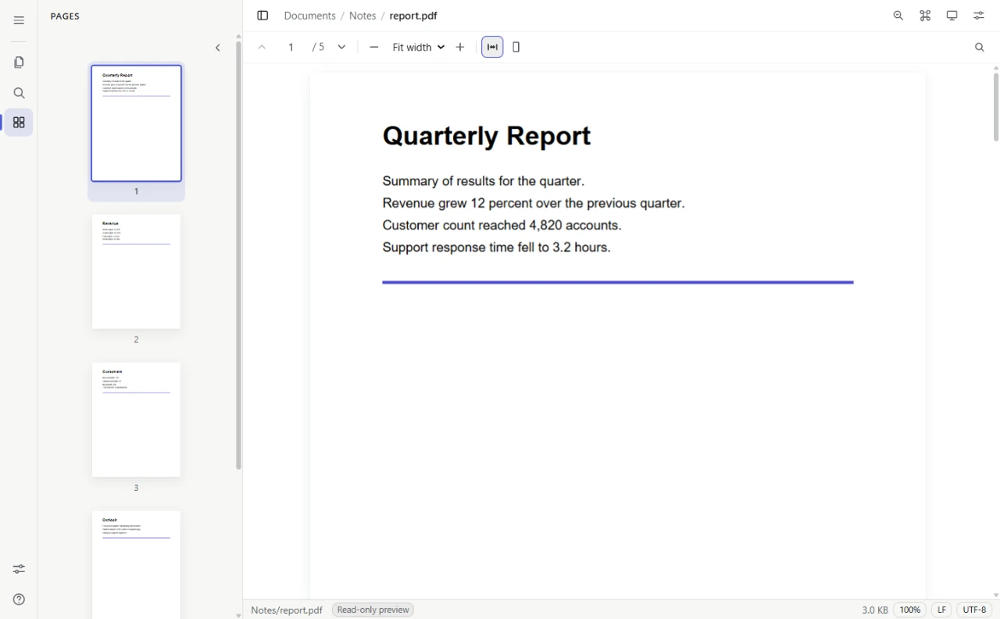
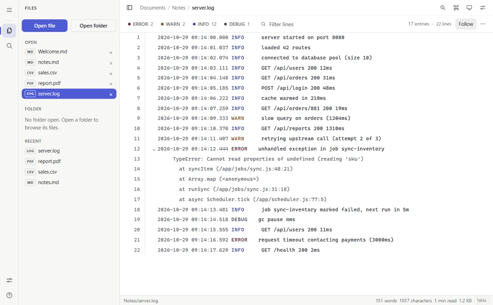
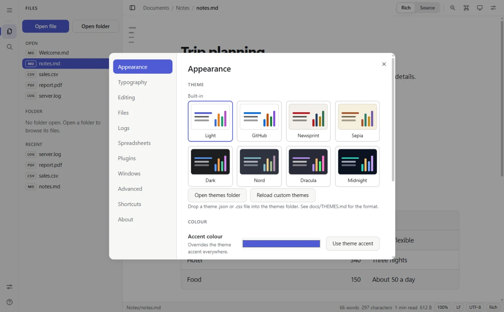

<div align="center">


# Plume

**A free, open-source universal file editor. Open and edit Markdown, text, logs, CSV, Excel and PDF, and read Word files, in one fast app.**

[](https://github.com/SamuelNDCE/plume/releases/latest)
[](LICENSE)


<a href="https://github.com/SamuelNDCE/plume/releases/latest"></a>

[What it is](#what-plume-is) &nbsp;·&nbsp; [Features](#features) &nbsp;·&nbsp; [Install](#install) &nbsp;·&nbsp; [Build from source](#build-from-source) &nbsp;·&nbsp; [Security](#security) &nbsp;·&nbsp; [Changelog](#changelog)

<br>



</div>

## What Plume is

Plume opens a file instantly and shows it the way it should look: Markdown as a finished page you type into, a CSV as a spreadsheet grid, a PDF with its page list, a log with its levels. It has no account, no telemetry and no subscription. Everything about how it looks can be changed, and anyone can write a theme or a plugin.

## Screenshots


The rich editor. Headings, lists, tables, code and links look finished while you type.



The same document as highlighted source. Press **`Ctrl+/`** to flip between the two.


Four of the eight built-in themes: Light, Sepia, Dark and Midnight.



The menu button at the top left. Save and Save As are at the top, and Go to line and Search in folder sit beside Find and Replace.



Select text and the selection bar appears just below it. Its block style drop-down is open here.



A CSV file in the spreadsheet grid, with find and replace open.



A PDF with the page list down the left and a highlight on the page.



A log file with level counts, filtering and collapsible stack traces.



The Settings page. Press **`Ctrl+,`** to open it.

## Features

### Markdown

- Rich editing on ProseMirror, with a slash menu. Press **`Ctrl+/`** to flip to the raw source and back. Your edits carry across both.
- Select text to get a one-row selection bar: block style (Paragraph, Title, Heading 2 to 6, Quote, Code block), Bold, Italic, Underline, Strikethrough, Code and a text size drop-down.
- Right-click for the full menu. The selection bar sits on top of it, and the rows below are grouped as Clipboard, Link, Quote and lists, Find, and More.
- Underline is stored as an HTML `<u>` tag, so it is refused for text that contains `<` or `>`.
- Tables, task lists, footnotes, fenced code with highlighting and KaTeX math.
- Mermaid diagrams, loaded only when a document uses one, and built-in `chart` blocks (bar, line, area, pie) from a few lines of JSON.
- Paste or drop images. They are saved to an `assets/` folder beside the file.
- Find and replace (`Ctrl+F`, `Ctrl+H`) with case, whole word and regex. Command palette (`Ctrl+P`). Reading, zen and presentation modes. Spellcheck, word count and reading time.
- Export to self-contained HTML or PDF, print, or copy as Markdown or HTML.
- Outline rail: a slim strip of lines down the left edge, one per heading. Click a line to jump to that heading.

### Text and logs

- Plain text, JSON, YAML, XML, HTML and code open with syntax highlighting and line numbers (CodeMirror 6).
- Text opens and saves like Notepad. UTF-8, UTF-8 with BOM, UTF-16 and ANSI files open correctly. Encoding and line endings (CRLF, LF, CR) are kept exactly when you save, show in the status bar and can be changed there.
- Ln and Col, **`Ctrl+G`** go to line, **`Ctrl+Shift+D`** date and time, reopen a file with another encoding.
- Text files above 128 MiB open as a read-only preview of the first 5 MB and cannot be saved.
- Log view for `.log`, `.out` and `.err` files, and for files whose first lines look like logs. It has level counts and filters, follow mode and collapsible stack traces.

### Spreadsheets: CSV and Excel

- **CSV and TSV** open in a spreadsheet grid. Edit cells in place with a formula bar, undo and redo, copy and paste to and from Excel, and fill down and right.
- Formulas recalculate as you type: `SUM`, `AVERAGE`, `MIN`, `MAX`, `COUNT`, `IF`, `ROUND`, text functions and more. The CSV keeps the formula text.
- Sort, filter by column, resize columns, freeze the header row, insert and delete rows and columns, and switch delimiter.
- **`Ctrl+H`** opens find and replace for the selection or the whole sheet, with match case and whole cell options.
- A CSV saves back as plain text, and a file you only looked at is never changed.
- **Excel `.xlsx`** opens with sheet tabs, a cell value line and find. You can edit cells and save back to `.xlsx` with `Ctrl+S`.
- Excel limits: **Save As is not yet tested.** Edits are lost if the app restarts before you save. Edits and paste stay inside the existing data range. For a file with a calc chain, the chain is removed on save. Legacy `.xls` and `.ods` are not supported.

### PDF

- Page list down the left, zoom, fit width and fit page, find (`Ctrl+F`), and text selection and copy.
- Page keys: Down, Right and PageDown go to the next page and Up, Left and PageUp to the previous page when the page list has focus. Home and End go to the first and last page. Type a number to jump to that page, or press `Ctrl+G`. Press `F1` for the full list.
- Rotate a page with **`Ctrl+Shift+R`**. The rotation is saved into the file when you save.
- Print with **`Ctrl+P`** or the toolbar button.
- Edit tools: highlight, underline, sticky note and freehand ink. Delete, move, rotate and extract pages, and merge another PDF onto the end. Fill in form fields (text, checkbox, radio, drop-down). Undo and redo cover every edit, and nothing is written until you save.
- **Cover and retype** draws a white box over text and puts your new text on top. It does not edit the original text. The original text stays in the file under the white box.

### Word

- `.docx` files open in a viewer. **Word is read only.** The document is sanitised before it is shown.

### Working with files

- Open as many documents as you like. They sit in a left bar with folders, search and recent files.
- Search a whole folder with **`Ctrl+Shift+F`**. It runs in a background thread, can be cancelled and stops at 200 hits.
- Create, rename, trash and reveal files from the sidebar. Autosave, session restore, and automatic reload when a file changes on disk.
- On Windows, Plume shows as Plume in Open with and in Settings, and a one-time bubble offers to open Plume's page in Windows Default apps.
- Eight built-in themes, with fonts, sizes, widths and chart style in Settings. See [docs/THEMES.md](docs/THEMES.md) to write a theme and [docs/PLUGINS.md](docs/PLUGINS.md) to write a plugin.

### Keyboard shortcuts

| Keys | What it does |
| --- | --- |
| `Ctrl+O` / `Ctrl+Shift+O` | Open files / folder |
| `Ctrl+N` | New document |
| `Ctrl+S` / `Ctrl+Shift+S` | Save / Save as |
| `Ctrl+W` | Close document |
| `Ctrl+/` | Rich / source view |
| `Ctrl+P` | Command palette (prints, when a PDF is open) |
| `Ctrl+F` / `Ctrl+H` | Find / replace |
| `Ctrl+Shift+F` | Search folder |
| `Ctrl+G` | Go to line, or go to page in a PDF |
| `Ctrl+Shift+R` | Rotate the page in a PDF |
| `Ctrl+Shift+D` | Insert date and time |
| `Ctrl+,` | Settings |
| `F5` | Presentation |
| `Ctrl+=` `Ctrl+-` `Ctrl+0` | Font size |

The full list is in Settings, under Shortcuts.

## Plume compared with Notepad

Notepad is the small, fast text editor that comes with Windows, and it is the right tool for a quick plain-text note. Plume does more, in one window:

- Markdown rendered as you write, with a source view one shortcut away (`Ctrl+/`).
- CSV and Excel files in a spreadsheet grid, with formulas. Excel cells can be edited and saved back to `.xlsx`.
- PDF files with a page list, highlights, notes, page edits and form fields.
- Word `.docx` files, read only.
- Log files with level counts, filters and collapsible stack traces.
- Folder search, a left bar with open files and recent files, and eight themes.
- No account and no telemetry. The only network request is the optional update check, which you can turn off.

Notepad opens faster and takes far less disk space and memory. Plume is for the files Notepad does not render.


## Install

Download a build from [Releases](https://github.com/SamuelNDCE/plume/releases/latest).

| System | Download |
| --- | --- |
| **Windows** | `Plume-<version>-win-x64-setup.exe` (installer) or `Plume-<version>-win-x64-portable.exe` |
| **macOS** | `Plume-<version>-mac-arm64.dmg` |
| **Linux** | `Plume-<version>-linux-x86_64.AppImage` or `Plume-<version>-linux-amd64.deb` |

Plume is not code-signed yet (see [#1](https://github.com/SamuelNDCE/plume/issues/1)), so your system may warn you once:

- **Windows:** on the blue "Windows protected your PC" screen, click **More info**, then **Run anyway**.
- **macOS:** open **System Settings, Privacy & Security**, find the message about Plume, click **Open Anyway** and enter your password.
- **Linux:** mark the AppImage as executable first (`chmod +x`).

Updates are built in. Plume checks GitHub for a newer release at startup and shows a card with **Update**. The Windows installer and the Linux AppImage update in place. macOS, the portable Windows exe and the Linux `.deb` open the download page. Turn the check off in Settings, Files, Updates, and Plume makes no network requests at all.

## Build from source

You need [Node.js](https://nodejs.org) 20.19 or newer (or 22.12 or newer).

```bash
git clone https://github.com/SamuelNDCE/plume.git
```

```bash
cd plume
```

```bash
npm install
```

```bash
npm start
```

To make an installer for your system, run `npm run dist`. Output goes to `release/`. To work on Plume itself, see [CONTRIBUTING.md](CONTRIBUTING.md) and [DESIGN.md](DESIGN.md).

## Security

- No telemetry, no accounts, no ads. The only network request is the optional update check, which you can turn off.
- The window is locked down: context isolation and the sandbox are on, and Node integration is off.
- Plume only touches files you picked in a dialog, dropped on the window or opened with it, plus the folders you opened. Saves are atomic.
- Plugins are off by default, and they are not sandboxed.
- Release downloads ship with `SHA256SUMS.txt` and a build-provenance attestation.

Full details, and how to report a vulnerability privately: [SECURITY.md](SECURITY.md).

## Changelog

Every release is listed in [CHANGELOG.md](CHANGELOG.md).

## AI tools (MCP)

An optional, separate MCP server lets AI tools such as Claude Desktop or Claude Code read your Markdown and text files. It is local stdio only, reads (and only with `--allow-write`, writes) files inside the one folder you give it, and makes no network calls. Setup: [tools/plume-mcp/README.md](tools/plume-mcp/README.md).

## Built with

[Electron](https://www.electronjs.org), [Milkdown](https://milkdown.dev), [CodeMirror 6](https://codemirror.net), [pdf.js](https://mozilla.github.io/pdf.js/), [pdf-lib](https://pdf-lib.js.org), [Mermaid](https://mermaid.js.org), [KaTeX](https://katex.org), [Vite](https://vite.dev).

## Licence

[MIT](LICENSE). Free to use, change and share.
