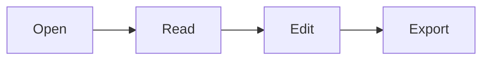

# Welcome to Plume

Plume is a free, open-source universal file editor. Edit Markdown, plain text, logs, spreadsheets and documents in one quiet, fast app, and view PDFs and Word files alongside them.

## Try it

- Type `/` for the block menu: headings, tables, code, math, images, diagrams
- Select text for a quick bar: Bold, Italic, Strikethrough, Code, and smaller and larger text
- **Ctrl+/** switches between rich view (formatted) and source view (the Markdown text)
- Right-click the document, or press Alt+F10, for the full menu: block style (all six headings, quote, code block, lists, task list, divider), formatting, link, and text size with presets
- **Ctrl+P** opens the command palette, **Ctrl+O** opens files, **Ctrl+,** opens settings
- **Ctrl+Shift+F** searches every file in the open folder
- **F8** focus mode, **F9** typewriter mode, **F5** presentation, **Ctrl+F** find and replace, **Ctrl+G** go to line (source view), **Ctrl+Shift+D** insert date and time

## PDF, Word and Excel

Open a PDF to read it with page controls and zoom. Open a Word `.docx` file to read it (read only). Open an Excel `.xlsx` workbook to browse its sheets and find text (read only for now, editing is not available yet). 

> Correction 2026-10-29 (later): Excel workbooks can now be edited and saved back to `.xlsx` with Ctrl+S (type, F2, Enter, Tab, Escape, Delete, undo and redo, cut and paste). Edits stay inside the existing data range, are lost if Plume restarts before you save, and Save As is not yet tested.

Log files (`.log`, `.out`, `.err`) open in a log view.

## Text files too

Plume opens plain text, logs, JSON, YAML, XML, config files, SQL, diffs, shell and PowerShell scripts, and common code files as text, with syntax colours in source view. Encoding and line endings are kept as they were, and you can change them from the status bar. Open a folder to browse its files in the sidebar.

## Everything in one place

| Feature | Status |
| --- | --- |
| Tables, task lists, footnotes | yes |
| Math (KaTeX): $E = mc^2$ | yes |
| Mermaid diagrams and charts | yes |
| Text, JSON, CSV, code and images | yes |

- [x] Open a file
- [ ] Write something great



```chart
{"type":"bar","title":"Charts are built in","labels":["Q1","Q2","Q3","Q4"],"datasets":[{"label":"2025","data":[12,19,7,15]},{"label":"2026","data":[16,23,14,28]}]}
```

## Make it yours

Eight built-in themes, your own fonts and chart style in **Settings** (`Ctrl+,`), or drop a theme file or a plugin into Plume's folders. See the README for how to build them.

On Windows, the first time you run Plume a bar at the bottom of the sidebar asks if you want it as your default app. **Open settings** takes you to Plume's page in Windows settings, where you pick Plume for Markdown and text files. **Not now** dismisses it for good. You can come back any time from **Settings, Files, Default app**. Windows keeps that choice, so Plume cannot set it for you.

## Export and share

Export to a self-contained HTML file or a PDF, copy as Markdown, or present the document as slides.

> Plume is MIT licensed. Make it yours.
